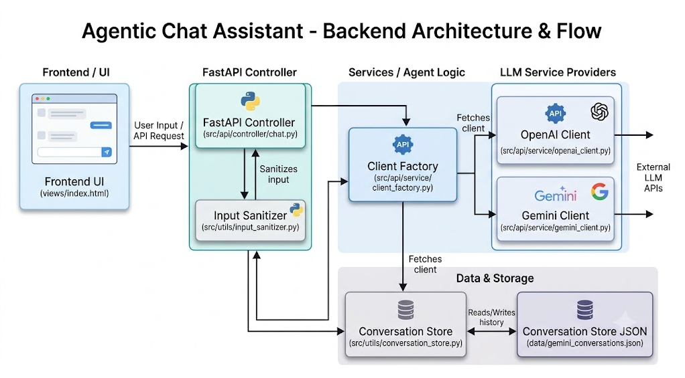
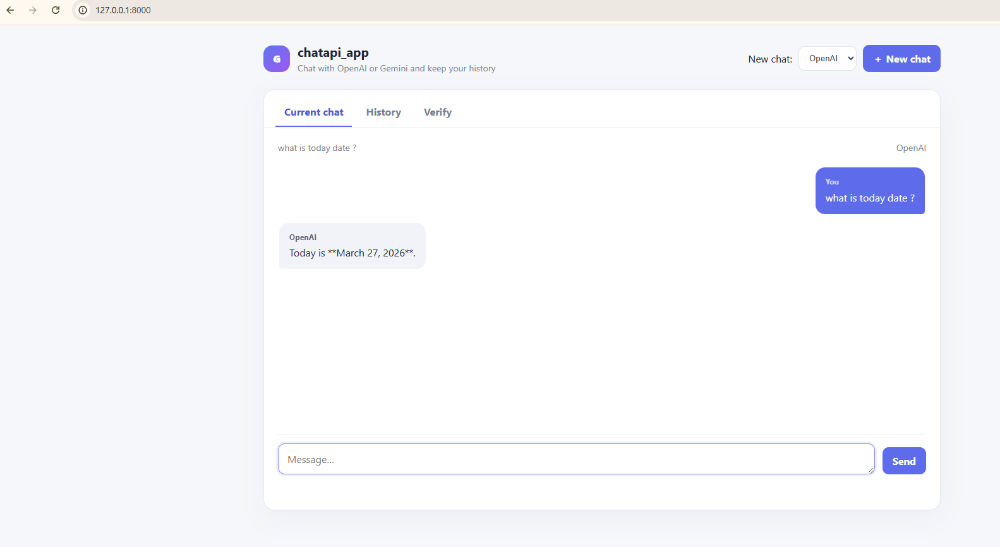
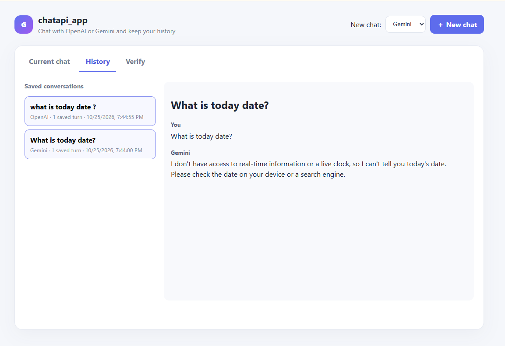
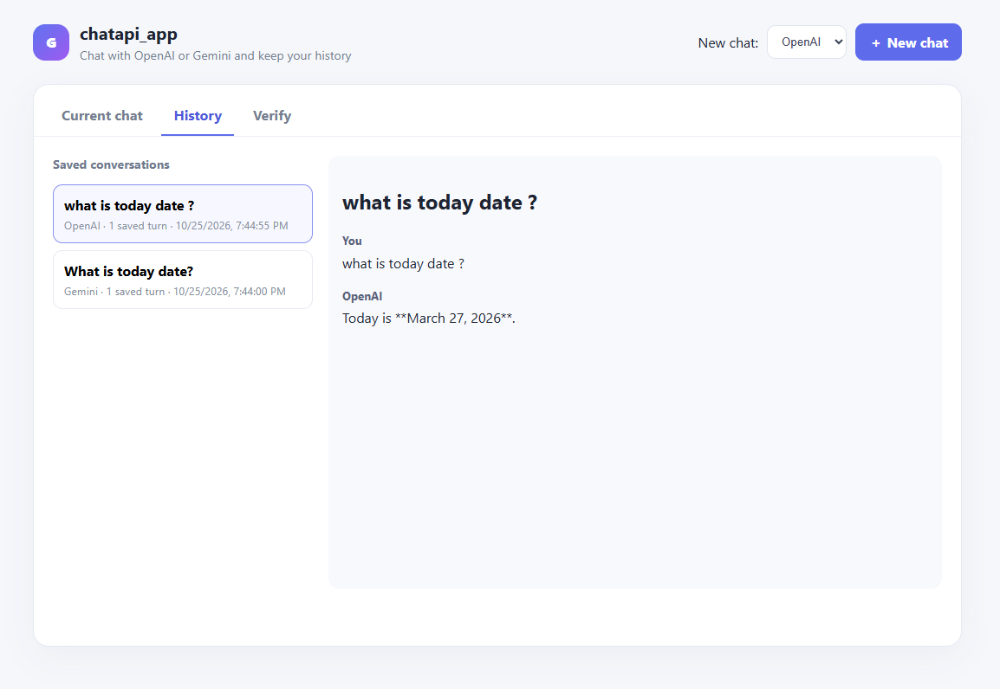
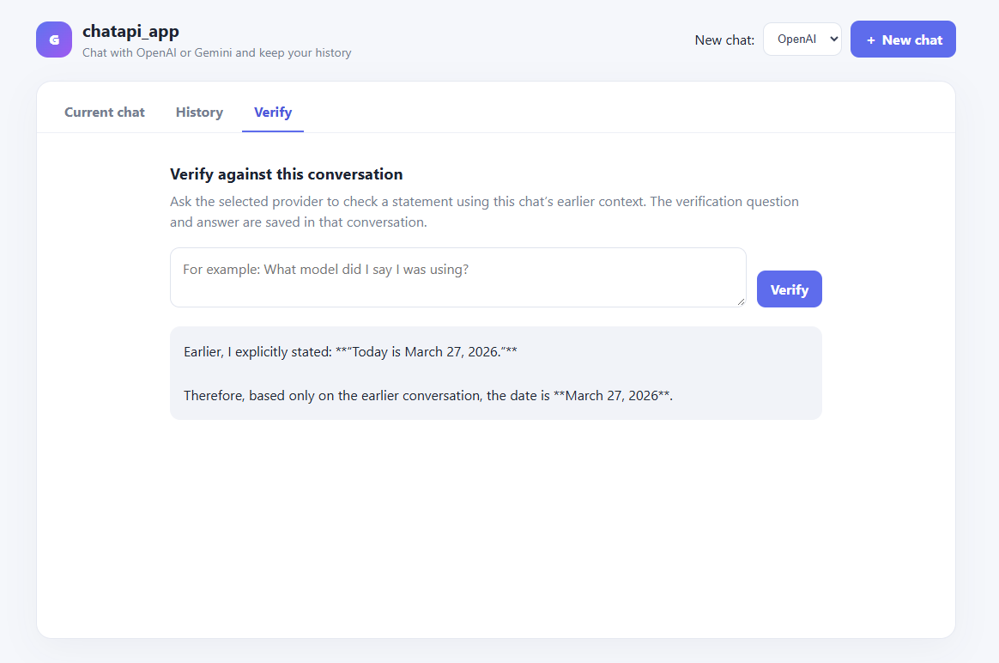

# Agentic Chat Assistant

A lightweight FastAPI application for chatting with OpenAI and Gemini models. It provides a browser-based chat interface, locally saved conversation history, and a verification flow that checks a statement against the current conversation.

## Features

- Start chats with either OpenAI or Gemini.
- Keep conversation context and saved history locally.
- Browse past conversations and review their messages.
- Ask a provider to verify a statement using the current conversation's earlier context; the verification exchange is saved to that conversation.
- Apply lightweight input sanitization and configure blocked terms with `CHAT_BLOCKED_TERMS`.

Input sanitization helps reduce obvious unsafe input patterns; it is not a full moderation or prompt-injection defense system.

## Architecture

The application separates the web interface, FastAPI controller, provider clients, configuration, and local conversation persistence.



### Request lifecycle

1. The browser UI in `views/index.html` sends a chat or verification request to the FastAPI controller.
2. The controller sanitizes input and loads the relevant conversation context.
3. The client factory selects the OpenAI or Gemini client.
4. The selected client sends the request to its provider's API.
5. Conversation turns are stored locally as JSON, and the response is returned to the UI.

### Key modules

| Module | Responsibility |
| --- | --- |
| `src/api/controller/chat.py` | FastAPI application, routes, request handling, and conversation flow |
| `src/api/service/client_factory.py` | Selects a provider client |
| `src/api/service/openai_client.py` | OpenAI API integration |
| `src/api/service/gemini_client.py` | Gemini API integration |
| `src/utils/conversation_store.py` | Reads and writes locally persisted conversations |
| `src/utils/input_sanitizer.py` | Cleans and validates user input |
| `src/config/` | Environment, logging, application, and model configuration |

## Application Screenshots

### Starting and using a chat



### Saved conversation history

The history view lists saved chats and displays the selected conversation.





### Verify a statement

The Verify view asks the selected provider to check a statement against the current conversation.



## Project Structure

```text
.
├── app.py
├── main.py
├── pyproject.toml
├── requirements.txt
├── src/
│   ├── api/
│   │   ├── controller/
│   │   └── service/
│   ├── config/
│   ├── constants/
│   ├── enums/
│   ├── exceptions/
│   └── utils/
├── views/
│   └── index.html
├── tests/
│   ├── test_chat_api.py
│   ├── test_input_sanitizer.py
│   └── manual/
├── data/                 # Local conversation data
├── logs/                 # Application logs
└── notebook/             # Architecture and application screenshots
```

## Getting Started

### Prerequisites

- Python 3.11 or newer
- An API key for each provider you want to use (OpenAI and/or Gemini)

### 1. Create and activate a virtual environment

```bash
python -m venv .venv
```

On Windows PowerShell:

```powershell
.\.venv\Scripts\Activate.ps1
```

On macOS or Linux:

```bash
source .venv/bin/activate
```

### 2. Install dependencies

```bash
pip install -r requirements.txt
```

### 3. Configure API keys

Create a `.env` file in the project root and add the key or keys for the providers you plan to use:

```env
OPENAI_API_KEY=your_openai_api_key
GEMINI_API_KEY=your_gemini_api_key
```

The application loads `.env` values automatically. Keep this file private; it is ignored by Git and should never be committed.

Optionally, customize the comma-separated blocked terms:

```env
CHAT_BLOCKED_TERMS=term1,term2
```

### 4. Run the application

From the project root:

```bash
python main.py --reload
```

The `--reload` option enables development auto-reload. Open [http://127.0.0.1:8000](http://127.0.0.1:8000) in your browser.

## Usage

1. Choose OpenAI or Gemini for a new chat.
2. Start a chat and send a message.
3. Open **History** to browse saved conversations and review their messages.
4. Open **Verify** to ask the selected provider to check a statement using the current chat's earlier context.

## Tests

Run the automated tests from the project root:

```bash
pytest
```

Interactive provider demos are available under `tests/manual/`.

## Data and Logs

- Conversation data is stored locally under `data/`.
- Application logs are written under `logs/`.
- The `notebook/` directory contains the architecture diagram and application screenshots used above.

Generated conversation data and logs are local runtime artifacts. Avoid committing them unless you intentionally want to publish that data.
